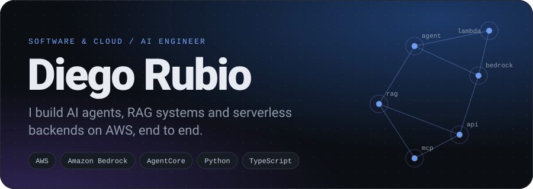
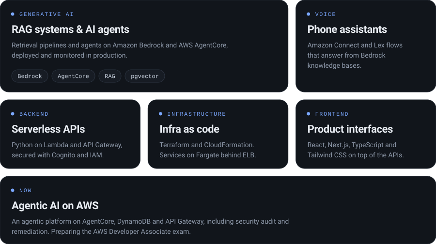
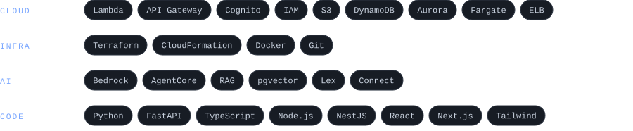

<picture>
  <source media="(prefers-color-scheme: dark)" srcset="./assets/hero-dark.svg">
  <source media="(prefers-color-scheme: light)" srcset="./assets/hero-light.svg">
  
</picture>

  
  
  

 

<picture>
  <source media="(prefers-color-scheme: dark)" srcset="./assets/bento-dark.svg">
  <source media="(prefers-color-scheme: light)" srcset="./assets/bento-light.svg">
  
</picture>

 
 

<picture>
  <source media="(prefers-color-scheme: dark)" srcset="./assets/stack-dark.svg">
  <source media="(prefers-color-scheme: light)" srcset="./assets/stack-light.svg">
  
</picture>

 
 

**Selected work.** Most of my recent work is for clients and private, so I describe it instead of linking it:

- **Agentic AI platform.** AI agents on AgentCore, configured from DynamoDB and exposed through API Gateway. I work on its evolution and on security auditing and remediation.
- **AI phone assistant.** A voice bot on Amazon Connect, Lex and Lambda that answers from a Bedrock knowledge base (RAG).

Earlier projects

 

- [Trivia Game](https://github.com/dieego17/Trivia-Game): HTML, CSS, JavaScript
- [VideoClub App](https://github.com/dieego17/VideoClub-Rubio): PHP, MySQL, Bootstrap
- [Physio Web](https://github.com/dieego17/Physio-Serrano): HTML, CSS, JavaScript, Bootstrap
- [Hotel Booking App](https://github.com/dieego17/Rubio-Hotels-MVC): PHP, MySQL, Bootstrap
- [Space Invaders](https://github.com/dieego17/Space-Invaders-Canva): JavaScript (Canvas), HTML, CSS

  Happy to talk about AWS, generative AI and cloud engineering. <a href="https://www.linkedin.com/in/dieego17/">Say hi on LinkedIn</a>.

