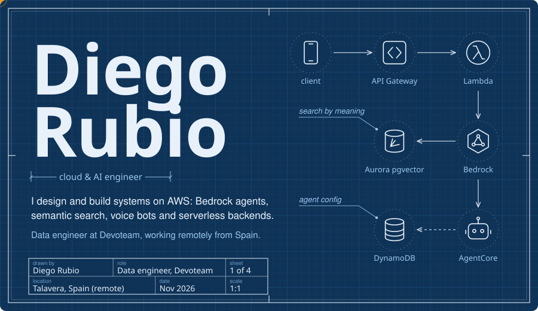
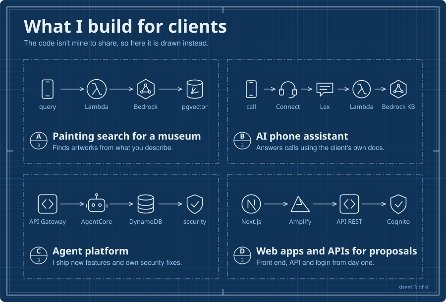
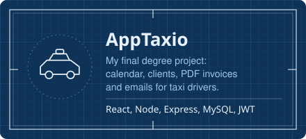
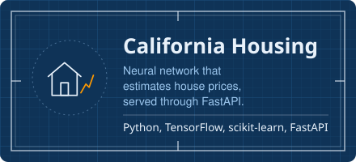
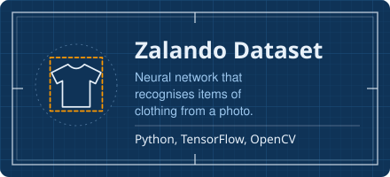
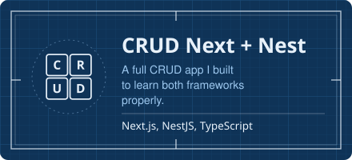
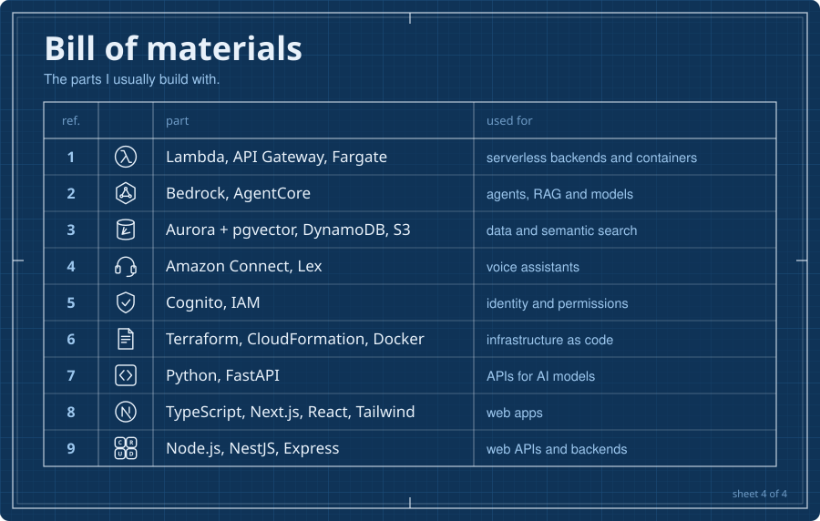

  
  
  

 

 
 

 
 

### Projects you can open

<table>
  <tr>
    <td width="50%"></td>
    <td width="50%"></td>
  </tr>
  <tr>
    <td width="50%"></td>
    <td width="50%"></td>
  </tr>
</table>

AppTaxio's backend lives in <a href="https://github.com/dieego17/TFG-AppTaxi-BackEnd">TFG-AppTaxi-BackEnd</a>. And if you're curious about where I started: <a href="https://github.com/dieego17/Space-Invaders-Canva">Space Invaders on Canvas</a>, <a href="https://github.com/dieego17/Rubio-Hotels-MVC">a hotel booking app in MVC</a> and <a href="https://github.com/dieego17/VideoClub-Rubio">a video store in PHP</a>.

 
 

  Currently studying for the AWS Certified Developer – Associate. Want to talk AWS or something you're building? <a href="https://www.linkedin.com/in/dieego17/">Message me on LinkedIn</a>.

