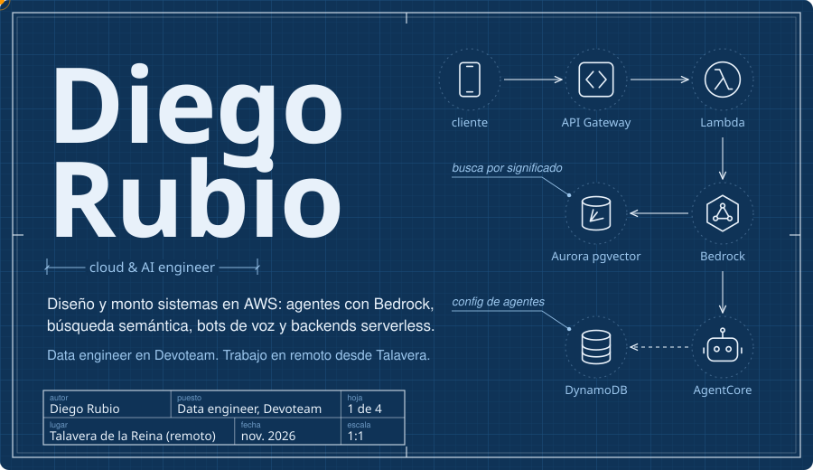
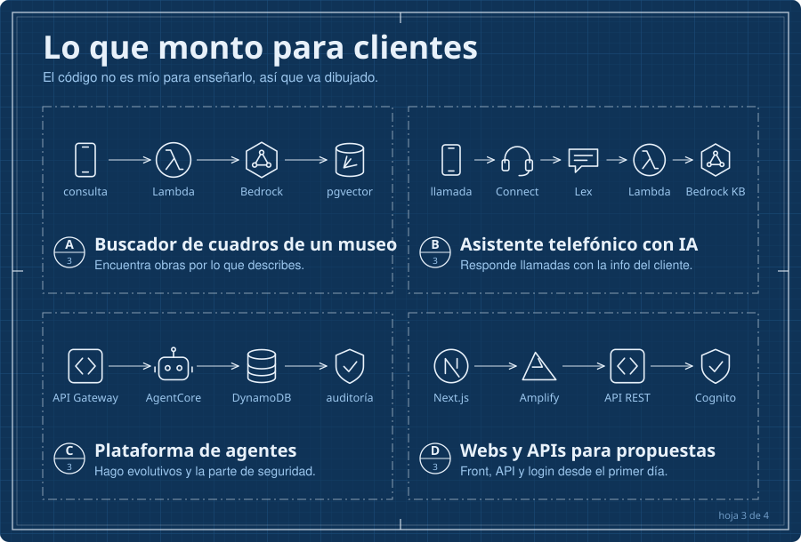
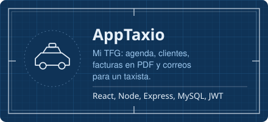
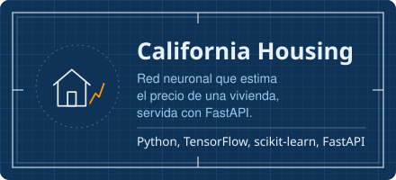
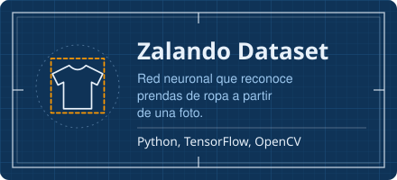
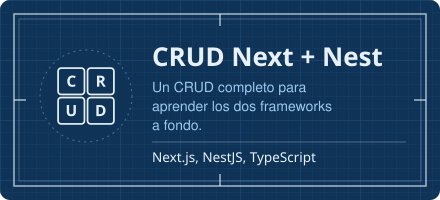
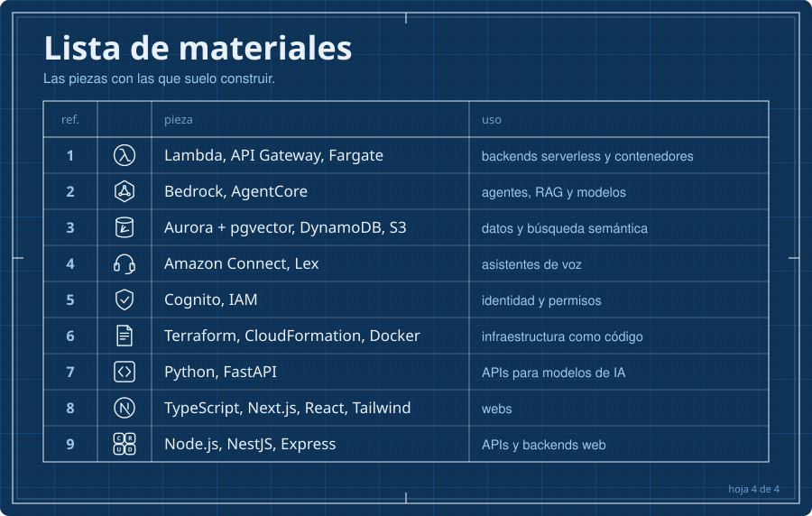

  
  
  

 

 
 

 
 

### Proyectos que sí puedes abrir

<table>
  <tr>
    <td width="50%"></td>
    <td width="50%"></td>
  </tr>
  <tr>
    <td width="50%"></td>
    <td width="50%"></td>
  </tr>
</table>

El backend de AppTaxio está en <a href="https://github.com/dieego17/TFG-AppTaxi-BackEnd">TFG-AppTaxi-BackEnd</a>. Y si te pica la curiosidad por cómo empecé: <a href="https://github.com/dieego17/Space-Invaders-Canva">Space Invaders en Canvas</a>, <a href="https://github.com/dieego17/Rubio-Hotels-MVC">reservas de hotel en MVC</a> y <a href="https://github.com/dieego17/VideoClub-Rubio">un videoclub en PHP</a>.

 
 

  Ahora mismo preparando la AWS Certified Developer – Associate. Si quieres hablar de AWS o de algo que estés montando, <a href="https://www.linkedin.com/in/dieego17/">escríbeme por LinkedIn</a>.

