<picture>
  <source media="(prefers-color-scheme: dark)" srcset="./assets/header-dark.svg">
  <source media="(prefers-color-scheme: light)" srcset="./assets/header-light.svg">
  
</picture>

### Hola, soy Diego 👋

Trabajo en Devoteam desde abril de 2025 y paso casi todo el día dentro de AWS. Empecé haciendo webs con PHP y React en clase, y he acabado montando agentes con Bedrock, bots de voz que atienden llamadas y buscadores que entienden lo que les pides en vez de buscar palabras sueltas.

Me gusta llevar las cosas de punta a punta: la infra, la API, el modelo y también el front. Y que lo que sale a producción sea seguro, que con IAM y Cognito no se juega.

### Lo último

El 4 de noviembre de 2026 ganamos el **AWS Media & Entertainment Agentic AI Partner Hackathon** en las oficinas de AWS en Madrid. Fuimos el equipo 5 de Devoteam y presentamos **DevoKiros**: le das un brief y unos agentes se encargan de sacar un anuncio de vídeo.

### En qué ando metido

Casi todo es para clientes, así que no puedo enseñar el código, pero sí contar qué es:

- Un **buscador de cuadros para un museo** que va por significado: Lambda, Aurora con pgvector, Bedrock y DynamoDB por detrás.
- **Bots de voz** en Amazon Connect + Lex que contestan llamadas tirando de una base de conocimiento en Bedrock. Ya lo he adaptado a más de un cliente.
- Una **plataforma de agentes** sobre AgentCore, configurada desde DynamoDB y expuesta por API Gateway. Aquí hago evolutivos y también auditoría y arreglos de seguridad.
- Fronts en **Next.js desplegados con Amplify** y APIs REST con Cognito para propuestas nuevas.

Y por mi cuenta estoy preparando la **AWS Certified Developer – Associate**.

### Cosas que sí puedes ver

| Proyecto | Qué es | Con qué |
| --- | --- | --- |
| [AppTaxio](https://github.com/dieego17/TFG-AppTaxi-FrontEnd) | Mi TFG. Gestión del día a día de un taxista: agenda, clientes, facturas en PDF y correos ([backend](https://github.com/dieego17/TFG-AppTaxi-BackEnd)) | React, Vite, Node, Express, Sequelize, MySQL, JWT |
| [California Housing API](https://github.com/dieego17/IA_housing_California_APIREST) | Modelo que predice precios de vivienda servido como API | Python, TensorFlow/Keras, scikit-learn, FastAPI |
| [Zalando Dataset](https://github.com/dieego17/Model_IA_Zalando_Dataset) | Red neuronal que reconoce prendas de ropa en imágenes | Python, TensorFlow, OpenCV |
| [CRUD Next + Nest](https://github.com/dieego17/CRUD-NextJS-and-NesJS) | CRUD completo para pelearme con los dos frameworks | Next.js, NestJS, TypeScript |

<details>
<summary>Y de cuando empezaba</summary>
<br>

Los guardo porque de aquí viene todo: [Space Invaders en Canvas](https://github.com/dieego17/Space-Invaders-Canva), [reservas de hotel en MVC](https://github.com/dieego17/Rubio-Hotels-MVC), [un videoclub en PHP](https://github.com/dieego17/VideoClub-Rubio), [la web de un fisio](https://github.com/dieego17/Physio-Serrano) y [un trivial](https://github.com/dieego17/Trivia-Game).

</details>

### Con qué trabajo

```text
cloud      Lambda · API Gateway · Cognito · IAM · S3 · DynamoDB · Aurora · Fargate · Amplify
ia         Bedrock · AgentCore · RAG · pgvector · Lex · Amazon Connect
backend    Python · FastAPI · Node.js · NestJS · TypeScript
frontend   Next.js · React · Tailwind
infra      Terraform · CloudFormation · Docker · Git
```

---

Si quieres hablar de AWS, de IA generativa o de algo que estés montando, escríbeme por [LinkedIn](https://www.linkedin.com/in/dieego17/).
